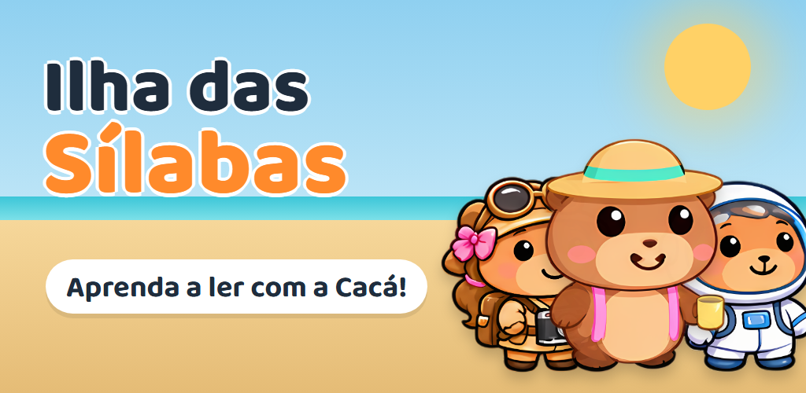
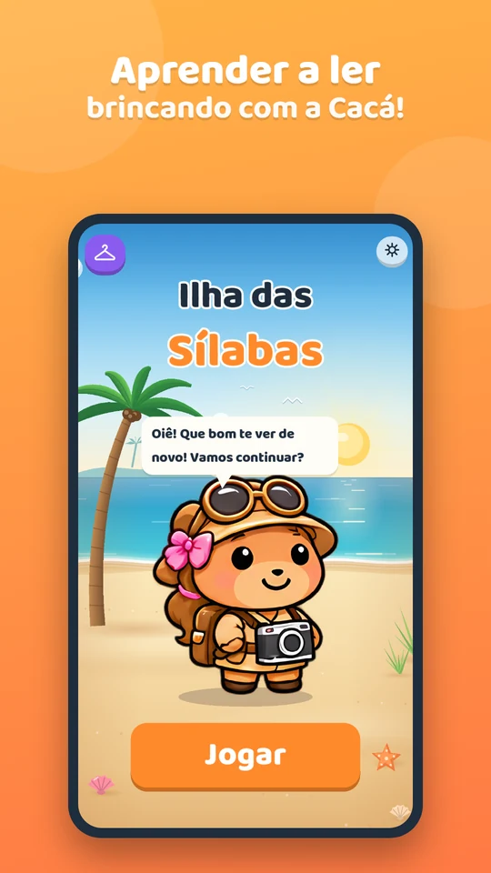
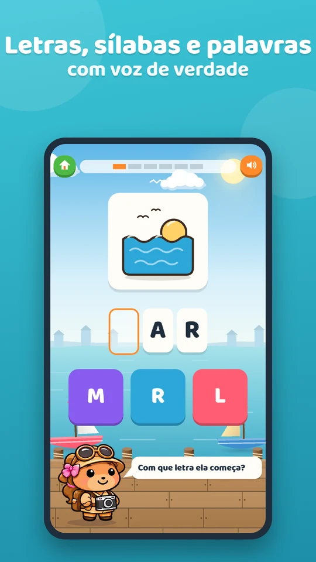
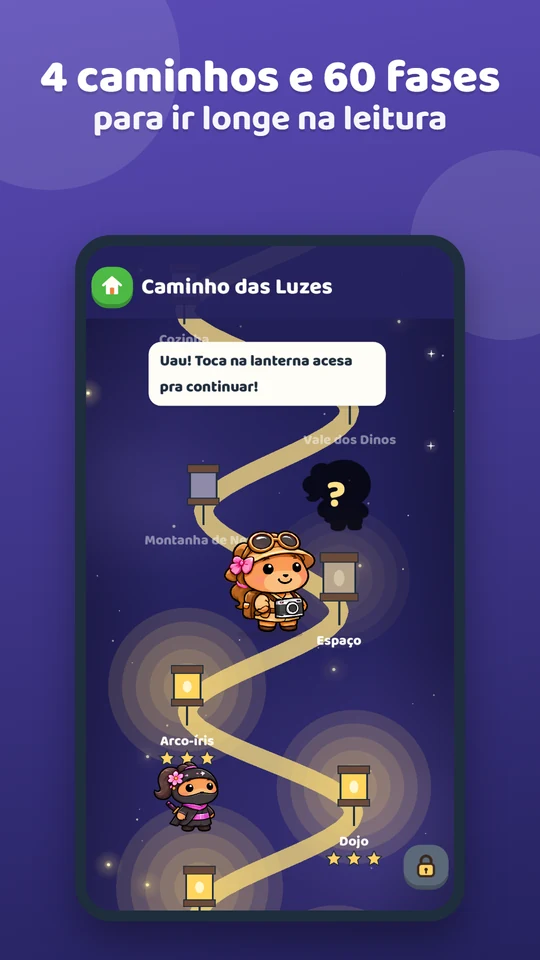
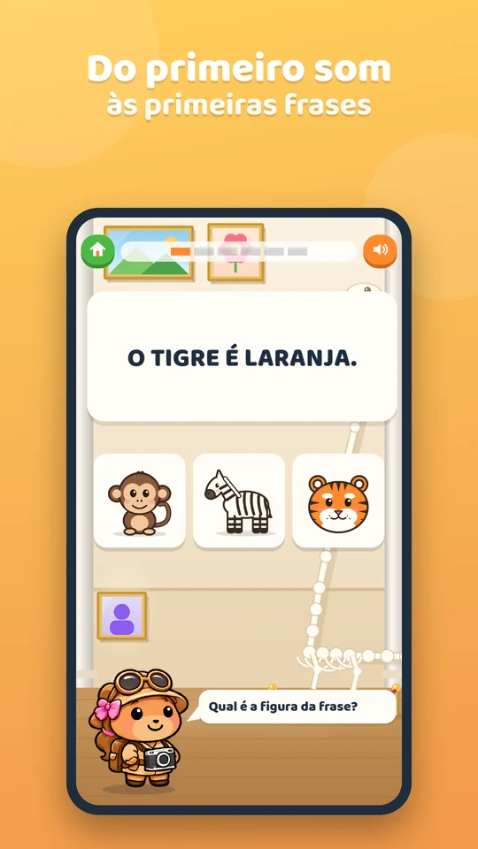
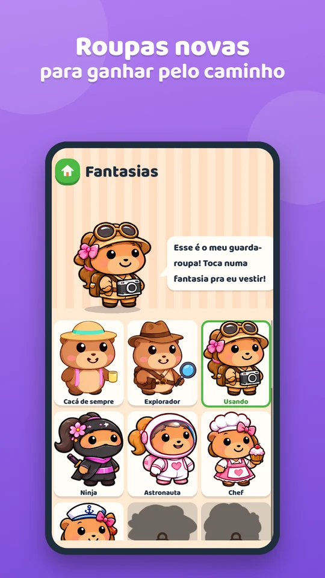
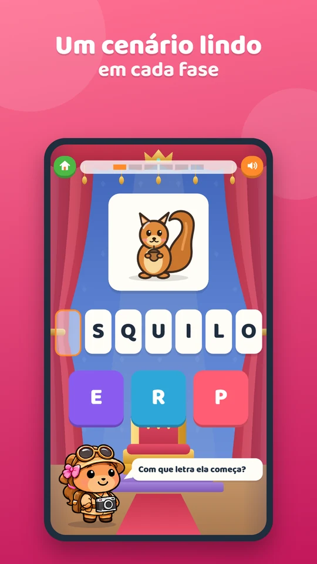
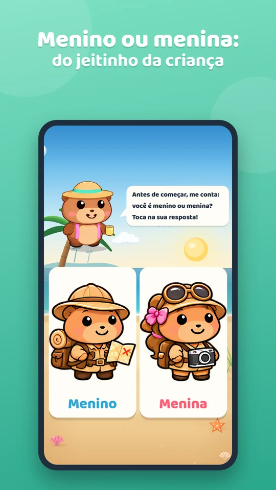
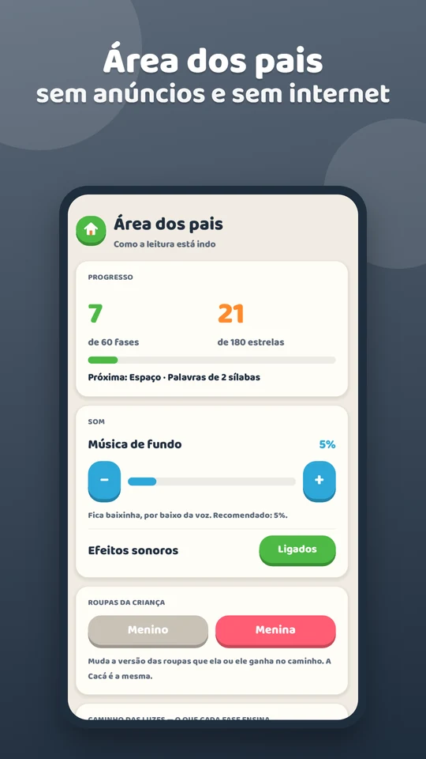

  

<h1 align="center">Ilha das Sílabas — aprenda a ler com a Cacá</h1>

  Jogo gratuito de alfabetização para <b>Android</b>, para crianças de 4 a 8 anos que estão começando a ler. 
  Letras, sílabas, palavras e frases, com voz de verdade, <b>sem anúncios</b> e <b>sem internet</b>.

  <a href="https://play.google.com/store/apps/details?id=com.ilhadassilabas.jogo"><b>Baixar na Google Play</b></a>

  

## Download

| Plataforma | Como instalar |
|---|---|
| **Android** | [Google Play](https://play.google.com/store/apps/details?id=com.ilhadassilabas.jogo). O jogo avisa e se atualiza quando sai uma versão nova. |

Versão atual: **1.2.1**.

## Telas

  
  
  
  

  
  
  
  

## O que o jogo faz

A Cacá, uma capivarinha muito animada, leva a criança numa aventura para aprender a ler, passo a passo e no tempo dela.

**Aprendizado**
- 🌟 **4 caminhos e 60 fases**: começa pelas vogais e sílabas simples, avança pelos sons mais difíceis (AR, ÃO, BL, CR, QU, Ç, X…) e chega à leitura de frases
- 🔤 **3 jeitos de brincar com cada palavra**: descobrir a primeira letra, completar a sílaba que falta e montar a palavra juntando os pedacinhos
- 🗣️ **Voz de verdade**: toda palavra e frase é narrada, e a Cacá comemora cada acerto e incentiva quando a criança erra

**Diversão**
- 👗 **Prêmios surpresa**: a cada 3 fases, uma roupa nova para a Cacá, na versão menino ou menina
- 🏝️ **Cenários**: praia, selva, fundo do mar, castelo encantado, a Lua e muito mais

**Para os pais**
- 👨‍👩‍👧 **Área dos pais** protegida por uma continha: progresso, o que cada fase ensina e volume da música
- ✅ Sem anúncios e sem coleta de dados
- 📶 Funciona sem internet

A Ilha das Sílabas é gratuita.

## Feito com

Godot 4 (GDScript) · Android nativo (plugin em Kotlin para atualização pela Google Play) · narração gerada e conferida palavra por palavra

## Suporte

- E-mail: **contato@hermiconsultoria.com.br**
- Desenvolvido pela [Hermi Consultoria](https://www.hermiconsultoria.com.br)

## Sobre este repositório

Este repositório guarda a página pública da Ilha das Sílabas.
O jogo é distribuído pela [Google Play](https://play.google.com/store/apps/details?id=com.ilhadassilabas.jogo), e o código-fonte é fechado.

> ⚠️ **Aviso legal**
> Este software é fornecido gratuitamente e "no estado em que se encontra", sem garantias de qualquer tipo.
